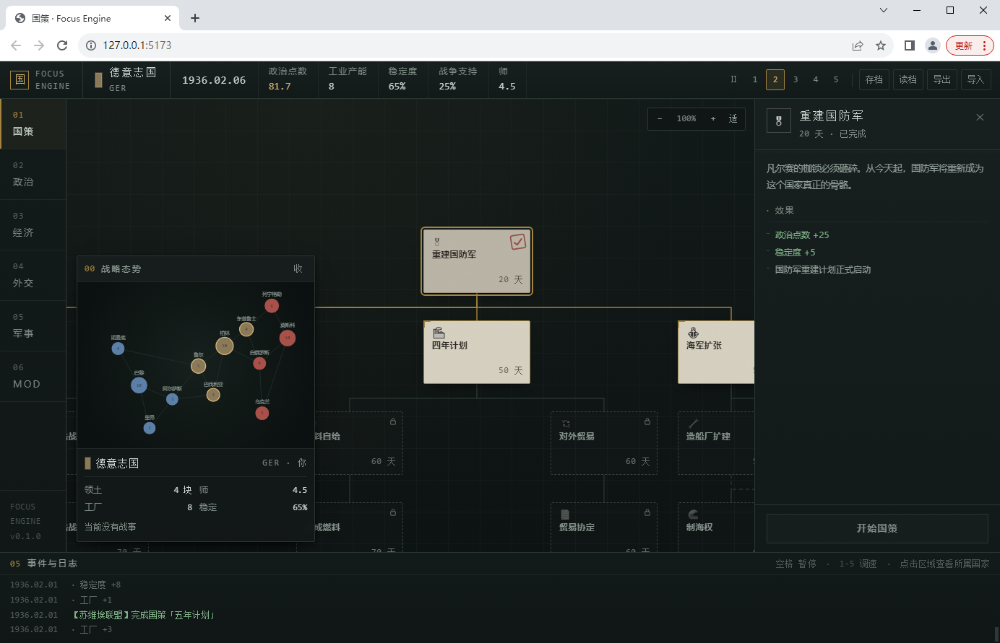
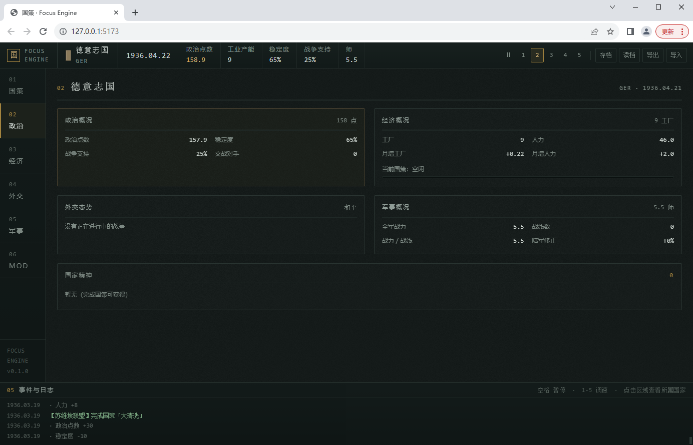
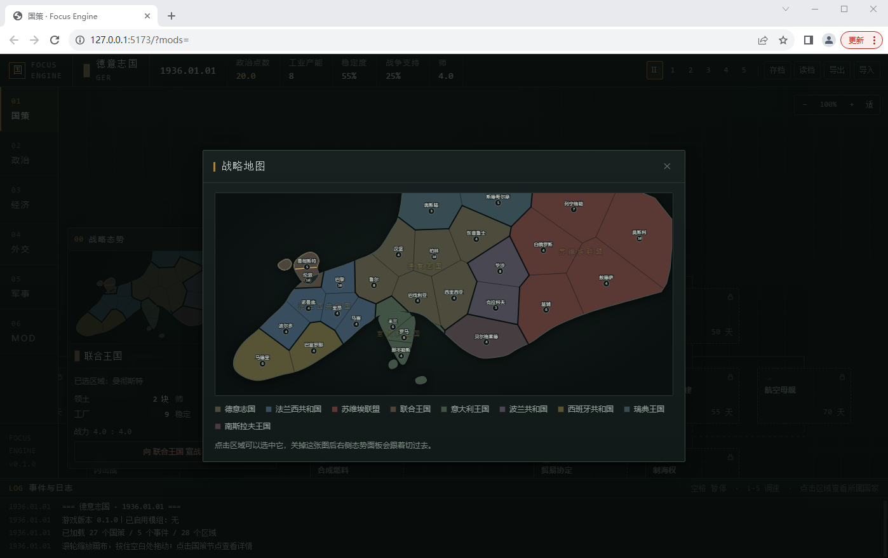
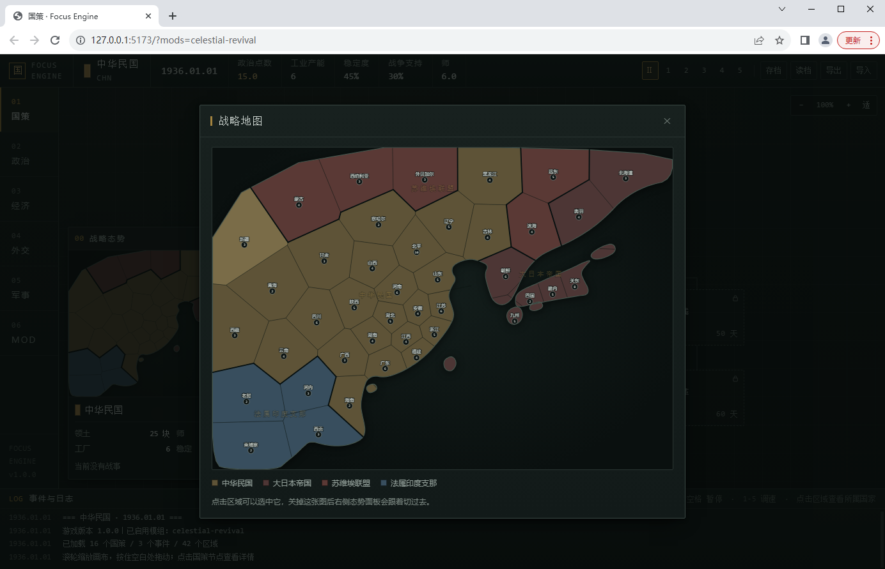
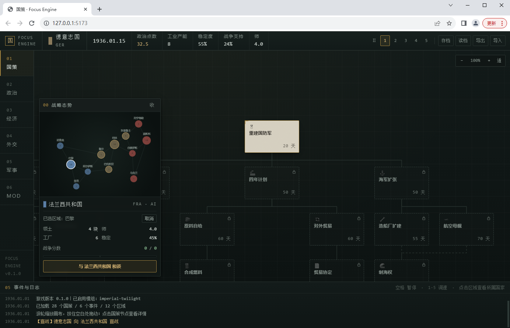
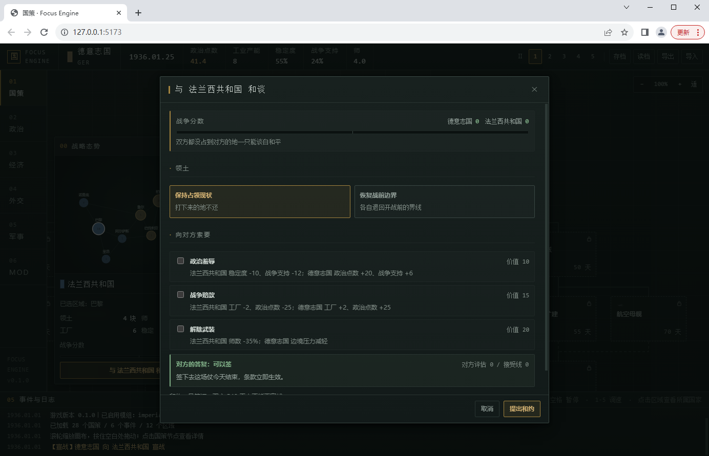

# 国策 · Focus Engine 骨架

一个**零依赖、无需构建**的轻量级国策树策略游戏骨架。用原生 ES Module + SVG 写成，
打开就能玩，代码可以按需替换成 React / Svelte / 任何框架。

> 目标不是做完整游戏，而是把「数据驱动 + mod 优先 + 存档版本化」这三根骨头立起来。
> 你往里填内容，游戏就长大了。



---

## 视觉语言

一套「档案馆 / 内阁会议室 / 旧地图」的界面，不是复古海报。

### 三条自我约束

1. **纸面是局部材质，不是全局底色。**
   承载面是深墨绿灰（`#101615`），米灰纸张只出现在"需要被拿在手里看"的东西上：
   国策节点、档案卡片。全屏纸色会晃眼，也会把信息密度压垮。

2. **纹理只做背景层，且低到"不刻意看就注意不到"。**
   噪点是烘成 data-URI 的 SVG，不是运行时滤镜——画布每帧重绘，实时滤镜会掉帧。

3. **强调色分工。**
   铜金 = 可交互（选中 / 主按钮 / 可用节点）；暗红 = 既成事实与不可逆（已完成印章 / 宣战）。
   如果两者混用，"选中"和"完成"会撞成同一个颜色。

### 国策节点的四种状态

每种状态都有独立的**形状线索**，不靠颜色区分：

| 状态 | 线索 |
| --- | --- |
| locked | 虚线边框 + 锁形图标 + 降饱和 |
| available | 米灰纸面 + 铜线边框 + 左上角 L 形角标 |
| current | 纸面 + 铜线 + 底部暗红进度条 |
| completed | 发暗的纸面 + 右上角倾斜的**暗红印章** |
| selected | 实线铜环；键盘焦点是**虚线**铜环——环的形状不同，不会混淆 |

`locked` 刻意不把文字压到看不清：锁着的节点通常占全树七成，如果最大面积的东西最难读，
整棵树看起来就像没渲染完。

### 色板是算过的，不是"看着还行"

所有色值都过了一遍 WCAG：

```
正文 #cdd5d0 on #101615 ......... 12.22 : 1   AAA
次要 #93a09a on #101615 .........  6.74 : 1   AA
弱化 #7e8a84 on #151d1c .........  4.78 : 1   AA
纸上 #2b2823 on #d6d0c0 .........  9.54 : 1   AAA
```

校验脚本就在仓库里，改色板时可以重跑：

```bash
node tools/contrast-check.mjs
```

### 布局与结构

```
顶栏  国家铭牌 · 日期 · 政治点 / 工业 / 稳定 / 战争支持 / 师 · 暂停与调速 · 存档
导航  01 国策  02 政治  03 经济  04 外交  05 军事  06 MOD
画布  可缩放拖拽的国策树（滚轮缩放、拖拽平移、0 键适应画布）
      左下角浮层「战略态势」：抽象地图 + 选中区域所属国 + 宣战 / 和谈
详情  选中节点的档案页：前置 / 互斥 / 效果 / 成本 / 开始国策（按钮固定在底部）
档案  政治 / 经济 / 外交 / 军事 共用一页国家档案（等宽数字 + 细线表格）
底部  事件与日志
```

导航用「索引号 + 名称」而不是图标：侧栏只有六个固定入口，
画一套识别度不足的线性图标，不如直接编号更像档案柜。



政治 / 经济 / 外交 / 军事 四页共用同一个档案渲染器，只是高亮不同的区块。
数据用等宽数字 + 细线表格排布，像档案里的统计页而不是仪表盘。

### 动效

150–250ms，只用 opacity 与 2px 位移，不弹跳、不炫光；
`prefers-reduced-motion` 下全部关掉。

---

## 运行

**在线版**：<https://gx6zm.github.io/Empire-Clan/>
（GitHub Pages 直接托管静态文件，不需要任何构建步骤）

本地跑：

```bash
cd focus-engine
python serve.py
```

会打开 http://127.0.0.1:5173/ （端口可改：`python serve.py 8080`）。

**不能直接双击 `index.html`。** 浏览器在 `file://` 下会拒绝 `fetch()` 本地 JSON，
而本作所有游戏数据都是运行时加载的。

需要 Node 时（跑测试）：

```bash
node tests/run.mjs
```

---

## 目录结构

```
focus-engine/
├── index.html              页面骨架（只有一个空壳）
├── serve.py                零依赖静态服务器（修了 Windows 的 MIME 坑）
├── package.json            只是为了 node 认 .js 是 ESM，没有依赖
│
├── src/
│   ├── main.js             入口
│   ├── styles.css
│   │
│   ├── core/               ← 纯逻辑，不含任何 DOM，可在 Node 里直接跑
│   │   ├── expr.js         表达式树求值器（触发器 / 数值 / 效果）
│   │   ├── rules.js        国策解锁、AI 选国策、事件触发与结算
│   │   ├── war.js          战争闭环（师、战线、争夺、占领、崩盘、战争档案、停战协议）
│   │   ├── peace.js        和谈（战争分数、条款价值、AI 的接受线、AI 主动求和）
│   │   ├── modifiers.js    国家修正（国家精神的聚合与格式化）
│   │   ├── state.js        状态创建 + 每日推进 + 月度经济结算
│   │   ├── load.js         数据加载、mod 合并、patch、完全替换
│   │   ├── validate.js     加载期校验（精确到文件）
│   │   ├── save.js         存档序列化 + 版本迁移
│   │   ├── describe.js     把 AST 翻译成中文（给 UI 和报错用）
│   │   └── rng.js          可复现的伪随机
│   │
│   └── ui/                 ← 只这一层碰 DOM
│       ├── app.js          主循环与状态编排
│       ├── nav.js          左侧索引式导航
│       ├── canvas.js       画布缩放 / 拖拽（transform，不用原生滚动条）
│       ├── tree.js         国策树（构建一次，之后只改 data-state）
│       ├── map.js          抽象地图（SVG 节点图，战况着色）
│       ├── hud.js          顶栏 / 战略态势 / 国家档案 / 日志
│       ├── dialogs.js      事件弹窗 / 和谈桌 / 求和提议 / mod 管理器 / 详情抽屉
│       └── dom.js          极简 DOM 工具
│
├── data/                   ← 这里的所有东西 mod 都能改
│   ├── base/
│   │   ├── game.json       版本、起始日期、国家与初始数值
│   │   ├── map.json        海岸线 + 28 个省的边界多边形（由 tools 生成）
│   │   ├── focuses.json    国策树（德国 20 节点，含 10 节点经济分支）
│   │   ├── events.json     事件
│   │   └── ideas.json      国家精神 + 它们的修正
│   └── mods/
│       ├── index.json      可选 mod 清单（含默认启用标记）
│       ├── imperial-twilight/   示例：用 patch 改数值 + 加国策
│       ├── hard-mode/           示例：用同 id 覆盖整条国策
│       └── celestial-revival/   示例：**完全替换**成 1936 年的东亚
│
└── tests/run.mjs           101 条断言，含真实数据的端到端
└── tools/
    ├── build-map.mjs      种子点 → 省份多边形 + 邻接表（Voronoi + 裁剪）
    ├── plot-map.mjs       ASCII 地图预览（终端里看形状对不对）
    ├── map-spec-europe.mjs / map-spec-eastasia.mjs   两张地图的源数据
    └── contrast-check.mjs 色板对比度校验（WCAG）
```

---

## 五个核心设计

### 1. 内容与代码彻底分离

`src/core/` 里**没有任何一条具体的国策或事件**。它只认识操作符：

```json
{ "op": "add", "target": "country.political_power", "value": { "op": "num", "value": 25 } }
```

所以你想加 300 个国策，一行代码都不用写。这是 P 社 Clausewitz 的思路，
也是这个骨架能承载 mod 的前提。

### 2. 逻辑是 JSON AST，不是脚本

触发器、数值、效果都是 JSON 节点，由 `expr.js` 解释执行，**全程没有 `eval` / `new Function`**。

* 安全：mod 作者无法执行任意 JavaScript。
* 可校验：加载时就能把每个 `op` 走一遍，写错立刻报错到文件。
* 可序列化：同样的结构既能求值，也能翻译成中文给 UI 显示。

### 3. 存档从第一天就带版本号

`save.js` 里 `SAVE_VERSION = 4`，并且已经有真实的迁移链（v0 → v1 → v2 → v3 → v4）。
加字段时改 `SAVE_VERSION`，然后在 `MIGRATIONS` 里 push 一条即可。
读档后还会调用 `reconcileWithData()`，把因为 mod 变更而失效的国策 / 事件 / 国家精神 / 省份
引用清理掉，而不是让游戏崩在玩家脸上。

战争档案（`state.wars`）有一点特殊：v3 的存档里只有"谁在跟谁打"，没有**开战时的边界快照**。
旧存档读进来时，`reconcileWars()` 会以**当前边界**补一份基准，让分数从 0 重新算起——
不能凭空给一个打到一半的老存档发一笔战果。

### 4. 国家精神：让取舍留下长期的账
**为什么"取舍"能成立**：每完成一个国策，除了当场的数值变化，还会获得一个**国家精神**。
国家精神带有长期修正（有正有负），比如「自给自足」给你 +18% 工厂产出，但同时每天扣 0.25 政治点数。
这些修正是加法的，正负自然抵消，玩家能心算。**一条路线的代价会一直跟着你。**

### 5. 一切皆数据，所以可以整个换掉

不只是"能加内容"，而是**能换成另一个游戏**：地图、国家、国策树、国家精神、事件、起始日期、
玩家国家——全都在 `data/` 里。一个 `replacesBase: true` 的 mod 可以让 `data/base` 完全不被加载。

`src/core/` 里没有一行代码知道"德国"或"1936"。这条约束是靠测试守住的：
完全替换 mod 的端到端测试会断言「基础游戏内容完全不存在」。

---

## 经济分支：一个完整的取舍设计

德国国策树里有一条 10 节点的经济分支，是"真实取舍"的样板：

```
                    四年计划
                   （+8% 产出 / -0.10 PP每日）
                    ／                 ＼
            原料自给                    对外贸易
      （+18% 产出 / -0.25 PP）      （+0.45 PP / -12% 产出）
                |                          |
            合成燃料 ▸ 需 50 PP         贸易协定 ▸ 需 40 PP
                |                          |
            合成橡胶                   大陆市场 ▸ 必须处于和平
                |                          |
                └──────► 战争经济 ◄────────┘
                              |
                          军工优先 ▸ 需 80 PP
                              |
                          总体战 ▸ 需 30 座工厂
```

两条路线互斥，而且是**两种完全不同的经济体质**：

| | 自给路线 | 贸易路线 |
|---|---|---|
| 工厂产出 | 极高（累计 +38%） | 低（甚至负修正） |
| 政治点数 | 每天净扣 0.35 | 每天净收 0.45 以上 |
| 稳定度 | 一路下滑 | 稳中有升 |
| 到「总体战」门槛 | 快，但可能凑不齐 80 PP | 慢，但 PP 宽裕 |
| 失败方式 | 政治破产，卡在军工优先 | 工业不够，够不到 30 座工厂 |

这就是取舍的本质：**它不是"好选项 vs 坏选项"，而是"两种不同的死法，你得选一种活得下去的"。**

配套的机制保证代价是真的：

* **政治点数有软上限**——存量超过 200 / 400 后每日产出减半/四分之一，挂机攒钱救不了你。
* **稳定度跌破 30**——政治产出直接腰斩。
* **多项国策要花政治点数（`pp_cost`）**——走到一半掏不出 80 点，就得停下来等。
* **工厂被动增长被压到每月 0.22 座**——不点经济线，你永远到不了 30 座工厂的门槛。

---

## 战略地图



地图从"节点图"换成了**政治地图**：陆地轮廓 + 省份多边形 + 国境线。

```
海岸线（手写）  +  省会种子点
        │
        ├─ Chaikin 角切割 ── 折线海岸 → 曲线海岸
        ├─ Lloyd 松弛 ×5 ── 种子点反复挪到各自单元的形心
        ├─ Voronoi 划分 ── 每个点"离谁最近"
        └─ 用陆地多边形裁切（凹多边形 + 凸半平面裁剪）
                ↓
        省份多边形 + 算出来的邻接关系
```

**为什么要有 Lloyd 松弛**：直接拿手放的种子做 Voronoi，单元面积能差出几十倍——
西伯利亚一格盖过整个法国，低地国家挤成几条缝。反复把种子挪到自己单元的形心，
格子会逐渐变得等大。生成器会把离散度打出来：

```
europe    28 个省　面积 最小 0.25× 中位 7601 最大 2.87×
eastasia  42 个省　面积 最小 0.06× 中位 9832 最大 2.14×
```

松弛之前这个数会到 10× 以上。

**国境线是算出来的，不是画出来的。** 相邻两省在多边形里共享同一条边，
渲染时比一下两边归属：不同就画一条深色线。所以打下柏林之后，
国境线自己会挪过去——它反映状态，而不是数据。

手画 40 个省的多边形不现实，手画一条海岸线是现实的。所以省界由
`tools/build-map.mjs` 生成，`map.json` 里存的是结果：

```jsonc
{
  "viewBox": [30, 210, 970, 430],
  "land": [[[x, y], ...]],            // 海岸线
  "defs": [{
    "id": "berlin", "owner": "GER", "vp": 10,
    "x": 462, "y": 366,               // 标签锚点（形心）
    "poly": [[x, y], ...],            // 省界，群岛则是环的数组
    "neighbors": ["hamburg", ...]     // 算出来的
  }]
}
```

有了它，**完全替换型 mod 换的是整块大陆**：



`celestial-revival` 从 10 个省扩到 **42 个省**，覆盖中国本部、满洲、蒙古、
新疆西藏、朝鲜、日本四岛、台湾海南、法属印度支那。地图文件全部由同一套
工具生成，mod 里没有一行代码。

### 两个能省几小时的工具

| 工具 | 作用 |
| --- | --- |
| `node tools/build-map.mjs` | 种子点 → 多边形 + 邻接表，写进 map.json |
| `node tools/plot-map.mjs` | 在终端打一张 96×40 的 ASCII 预览 |

ASCII 预览是这次最有用的东西。手写海岸线出错时，浏览器里只表现为
"几块莫名其妙的大三角"，看不出是哪一段写坏了；在终端画一张字符图，
十秒钟就能定位。生成器还会做**自相交检查**——我画希腊时把伯罗奔尼撒
折成了一个 X，裁剪算法不会报错，但会把整块地算错。

---

## 战争闭环

经济线攒出来的工厂、军工优先攒出来的师，现在有地方兑现了。



模型小到可以一句话说完，但每一步都能解释：

```
全军攻击力 = 师 ×(1 + 陆军战力修正)
战线力量   = 全军攻击力 / 战线数^0.35
防守力量   = 战线力量 ×(1 + 地块价值 × 0.025)

每天，每块地被最强的那条相邻敌军战线推一把：
  争夺值 += (进攻方战线力量 ×1.1~1.4 − 防守方在该地的力量) × 1.5
争夺值满 100 → 地块易手
一个国家失去全部省份 → 崩盘，退出所有战争
```

* **师** 每月按 `0.06 × 工厂` 增长，军事国策会直接给。
* 地图上被争夺的省份会**红色描边 + 呼吸动画**，越接近易手线条越粗。
* 日志会记下每一次「攻占」和最后的「停战」。
* 选中别的国家，国家面板会显示**战力对比**、当前**战争分数**和「宣战 / 和谈」按钮。
* **打仗是有代价的**：每多一个交战对手，政治点数产出就 `×(1 − 0.12×敌人)`。
  这条是让"和谈"对**赢家**也有意义的关键——否则打赢了就该无脑打到底。

为什么不做得更细：一旦引入补给、地形、编制、装备，就要三个月起步。
现在这个版本已经能回答"我点满军工优先到底换来了什么"。

---

## 和谈



战争只能回答"谁在推进"，回答不了"什么时候停"。以前只有一种结局：打到对方全灭。
现在任何时候都能坐上谈判桌——**包括你正在输的时候**。

### 战争分数

```
分数 = 我占了他开战国土的百分比 − 他占了我开战国土的百分比
      （按区域价值 vp 加权，双方互为相反数）
```

所以 `+67 / −67` 一眼就能读懂：德国拿走了法国 67% 的国土价值。
地图上被占领的省，谁的旗子就是谁的——**地是打下来的，谈判不能凭空变出来**。

### 条款

| 条款 | 价值 | 付方 | 收方 |
| --- | --- | --- | --- |
| 政治羞辱 | 10 | 稳定度 −10、战争支持 −12 | 政治点数 +20、战争支持 +6 |
| 战争赔款 | 15 | 工厂 −2、政治点数 −25 | 工厂 +2、政治点数 +25 |
| 解除武装 | 20 | 师数 −35% | 边境压力减轻 |

领土另有两个选项：**保持占领现状**（打下来的不还）或**恢复战前边界**（各自退回开战线）。
恢复边界对赢家是纯让步，一般只在你想快点脱身时才用。

### 对方为什么会签

AI 拿这份和约跟"继续打下去"比较：

```
赢家：接受线 = 分数 × 胃口(1.25 − 厌战)      ← 我们在赢，血不能白流
输家：接受线 = 分数 × 容忍(1.35 + 厌战)      ← 再打下去只会更糟，赶紧止损
```

* 赢家的胃口**大于 1**：赢着的一方会多要一点"血债"。所以哪怕你在输，也不是签个字就能走的。
* 输家的容忍**大于 1**：它愿意付出比已经丢掉的更多的代价来止血。这个差值就是你能索要的空间。
* **厌战** = 战争打了多久 + 稳定度/战争支持还剩多少 + 被拒过几次。

于是有了一个能磨的循环：

> 打 → 分数涨 → 提出条件 → 被拒（**政治点数 −10**）→ 对方更厌战 → 再谈，接受线更低

被拒不是白拒的：对方厌战度 +0.04，下次开价就软一点。但你的政治点数是真的在掉。

### AI 会主动投降

当 AI 输到 −30 分以下、开战超过 40 天、并且国内快散架时，它会**主动递话**，
并且在自己的容忍范围内主动加码（赔款 / 解除武装）。玩家可以选择收下，
也可以拒绝——拒绝会让它更厌战，下一次开出的条件更低，但战争也要多流血。

### 停战协议

和约签订后双方 **540 天**内不能再宣战（`state.truces`）。没有这条，
"停战"就只是"暂停"，和约的价值会瞬间归零。

---

## 完全替换型 mod：换个 mod 就换个国家

`celestial-revival` 这个示例 mod 不带任何代码，只是五个 JSON 文件：

```json
// mod.json
{
  "id": "celestial-revival",
  "replacesBase": true,          // ← 关键：跳过 data/base
  "files": ["game.json", "ideas.json", "map.json", "focuses.json", "events.json"]
}
```

启用后整个游戏换掉：**新地图（42 块东亚省份）、新国家（中华民国 / 大日本帝国 /
苏联 / 法属印度支那）、新的 16 个国策、8 个国家精神、3 个事件**。玩家从德意志变成中华民国，
地图上从欧洲变成整个东亚，国策树叫「统一财政 → 实业计划 → 兵工署 → 工业总动员 → 决死抗战」。

三条保证它跑得起来的规则：

1. **`replacesBase: true` 会让 `data/base/*.json` 完全不被加载**——不是覆盖，是不存在。
2. 完全替换型 mod **独占加载**：同时启用的其他 mod 会被忽略并在日志里说明，
   否则一个 `patch GER_root` 的 mod 会立刻因为找不到目标而报错。
3. 代码里不能有写死的国家假设。这一条是靠测试保证的——
   「玩家国家、地图、国策树全部换成了新的」「基础游戏内容完全不存在」两条断言。

想直接试玩，不用点菜单——URL 参数：

```
http://127.0.0.1:5173/?mods=celestial-revival      只启用这一个
http://127.0.0.1:5173/?mods=imperial-twilight,hard-mode
http://127.0.0.1:5173/?mods=                       不带任何模组
```

---

## 数据格式速查

### 国策 `data/base/focuses.json`

```json
{
  "id": "GER_army",
  "tag": "GER",              // 必填。每个国家一棵独立的树
  "name": "陆军改革",
  "desc": "……",
  "icon": "⚔",
  "x": 2, "y": 1,            // 网格坐标，一列 182px
  "cost": 50,                // 天数
  "pp_cost": 50,             // 可选：启动要花的政治点数
  "prereqs": ["GER_root"],   // 全部满足
  "prereqs_any": [],         // 任一满足
  "mutually_exclusive": ["GER_navy"],
  "available": {             // 额外条件（任意触发器）
    "op": "cmp", "cmp": "gte",
    "lhs": { "op": "var", "path": "country.factories" },
    "rhs": { "op": "num", "value": 18 }
  },
  "effects": [ /* … */ ],
  "ai_weight": 12            // 0 = AI 永不主动选
}
```

### 事件 `data/base/events.json`

```json
{
  "id": "ev_rhineland",
  "title": "莱茵兰再军事化",
  "desc": "……",
  "flavor": "「我们赌的不是军队，是对方的犹豫。」",
  "for": "GER",              // 或 "any"
  "once": true,
  "manual": false,           // true = 只能被效果的 fire_event 触发
  "trigger": { "op": "has_focus", "id": "GER_root" },
  "options": [
    { "text": "冒险进军", "tooltip": "…", "ai_weight": 3, "effects": [ /* … */ ] }
  ]
}
```

玩家的事件会暂停并弹窗；AI 国家按 `ai_weight` 自动选择。

### 国家精神 `data/base/ideas.json`

国家精神是国策树"留下长期影响"的方式。`add_idea` 效果会把这些精神挂到国家身上，
它们的修正按月/按日持续生效。

```json
{
  "id": "autarky",
  "name": "自给自足",
  "desc": "与世界市场脱钩。工厂不再受制于进口，但配给制让每个人的日子都更难过。",
  "icon": "🧱",
  "modifiers": {
    "factory_output": 0.18,          // +18% 工厂产出
    "political_power_gain": -0.25    // 每天 -0.25 政治点数
  }
}
```

可用的修正器键（定义在 `src/core/modifiers.js`，加新的要同时更新校验器）：

| 键 | 含义 | 单位 |
|---|---|---|
| `factory_output` | 每月新增工厂的产出修正 | 百分比 |
| `political_power_gain` | 每日政治点数增减 | 每日 |
| `stability_drift` | 每月稳定度增减 | 每月 |
| `war_support_drift` | 每月战争支持度增减 | 每月 |
| `manpower_gain` | 每月人力增长修正 | 百分比 |
| `focus_speed` | 国策推进速度修正 | 百分比 |
| `army_strength` | 师的作战效能修正 | 百分比 |

### 操作符一览

| 类别 | 操作符 |
|---|---|
| 触发器 | `always` `and` `or` `not` `cmp` `has_focus` `has_flag` `country_flag` `at_war` `exists` `date_after` `date_before` |
| 数值 | `num` `bool` `var` `add` `sub` `mul` `div` `min` `max` `floor` |
| 效果 | `add` `sub` `mul` `set` `flag` `country_flag` `add_idea` `remove_idea` `declare_war` `make_peace` `fire_event` `log` |

取值路径只允许两个作用域：`country.*` 和 `global.*`。mod 无法触达其它对象。

---

## 写一个 mod

### 方式一：覆盖（override）

数据文件里出现与基础版本相同的 `id`，就整条替换：

```json
{ "type": "focuses",
  "defs": [ { "id": "GER_four_year", "tag": "GER", "cost": 95, "…": "…" } ] }
```

适合「我要彻底换掉这条国策」。缺点：基础版本改动时你的副本会失联。

### 方式二：补丁（patch）

只声明改动，不复制整条定义：

```json
{ "type": "patch",
  "ops": [
    { "action": "modify", "collection": "focuses", "id": "GER_root", "set": { "cost": 20 } },
    { "action": "add",    "collection": "focuses", "value": { "…": "新国策" } },
    { "action": "remove", "collection": "focuses", "id": "GER_shipyard" },
    { "action": "modify", "collection": "focuses", "id": "GER_army", "unset": ["mutually_exclusive"] }
  ]
}
```

适合「我只想改一个数字」，而且基础版本重写也不会挂。

### 注册 mod

```json
// data/mods/index.json
{ "mods": [ { "id": "imperial-twilight", "default": true } ] }
```

```json
// data/mods/imperial-twilight/mod.json
{
  "id": "imperial-twilight",
  "name": "帝国余晖",
  "version": "1.1.0",
  "gameVersion": ">=0.1.0",
  "loadAfter": [],
  "files": ["focuses.patch.json", "events.patch.json"]
}
```

加载顺序由 `loadAfter` / `loadBefore` 拓扑排序决定；`gameVersion` 不满足只警告不阻断。
在游戏里点「模组」可以开关并重载，选择会记在 localStorage。

---

## 加一个新的操作符

只改 `src/core/expr.js` 和 `src/core/validate.js` 两处：

1. 把名字加进 `TRIGGER_OPS` / `EFFECT_OPS` / `VALUE_OPS`。
2. 在 `evalTrigger` / `evalValue` / `applyEffect` 的 `switch` 里实现。
3. 在 `validate.js` 的 `checkTrigger` / `checkValue` / `checkEffects` 里校验参数。

忘了第 3 步也不会出事——校验器会把未知 op 当错误报出来。

---

## 已知限制（都是有意为之）

* **地图是示意性的，不是地理精确。** 海岸线是手描的粗轮廓，省份边界由 Voronoi
  生成——比例、形状、面积都不准，只保证"像那块地方"和"边界对得上"。
  真正的投影级地图（几千个 polygon + 命中检测 + 缩放）仍然是这类项目最大的单点成本。
* **战争是抽象推演。** 有战线、争夺、占领、崩盘、和谈，但没有补给、地形、编制、包围。
  一场仗的胜负只取决于师数和在地块上的距离。
* **AI 不会主动开战，但会主动求和。** 它会在可用国策里加权随机、会在撑不住时递话求和，
  但不会自己挑目标宣战、不会撤退、不会拒绝谈判到底。
* **政治点数只有两个去处**（国策启动成本、被拒的和谈条件）。决议 / 顾问 / 法案还没做。
* **和约条款是固定三种。** 割地是自动的（谁占着算谁的），不能点名要某一块省。
* **单机、无后端。** 存档在 localStorage 和你导出的 JSON 里。

## 下一步的优先级建议

1. **让 AI 会打仗**——现在宣战之后它只会站着挨打、最后求和，不会主动挑目标。这是最大的短板。
2. **和约条款可扩展成数据**（`data/base/peace.json`），让 mod 能加"割让特定省份 / 附庸 / 军事通行权"。
3. AI 会规划国策路线（"我在攒 80 点 PP，先别花"）。
4. 给政治点数第三个去处（决议 / 顾问）。
5. **海岸线编辑器**——现在改地图要手改坐标数组，有 ASCII 预览也得试几轮。
6. 把 `core/` 搬进 Web Worker，UI 与模拟彻底解耦。

---

## 测试

```
$ node tests/run.mjs
通过 101　失败 0
```

覆盖：表达式求值、国策解锁与互斥、政治点数成本与 AI 支付能力、国家修正的聚合与生效
（含 `focus_speed` 加速国策、`factory_output` 加速工厂增长、`army_strength` 加快推进、
数值夹取、政治点数软上限）、时间进位、mod 合并与 patch、校验器能抓到的错误类型、
存档 v0→v4 迁移，以及五组端到端：

* **军事线**：1936 走陆军路线并触发莱茵兰事件
* **经济线**：走完 10 节点自给分支，验证修正叠加、互斥锁死、PP 扣款、门槛解锁
* **战争闭环**：宣战 → 推进 → 占领 → 对方崩盘 → 战争结束；战力修正加快战局；停战清空争夺
* **和谈**：分数换算（含 vp 加权、互为相反数）、白和平归还领土、保持占领、超额索要被拒、
  反复谈能压低接受线、赔款与裁军真的转移数值、停战期内不能再宣战、
  AI 主动求和且条件不超出自己的容忍线、v3 老存档补建战争档案
* **完全替换 mod**：加载东亚地图与国策树、基础内容确实不存在、与其他 mod 共存时独占加载、
  打完整条抗战线、战争在东亚地图上真的推进、这个 mod 的存档同样能往返
